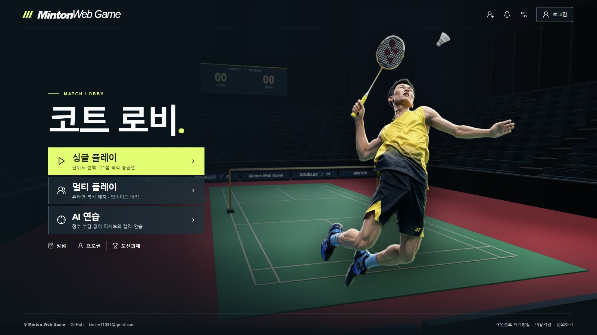
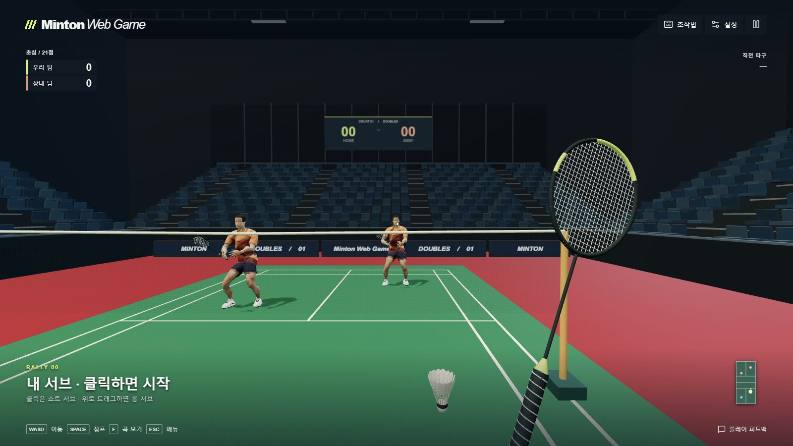
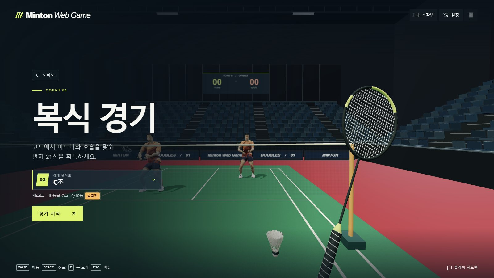
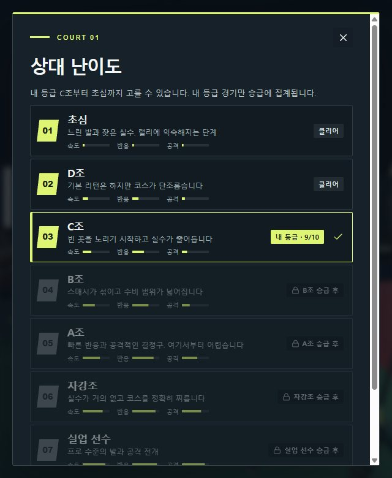
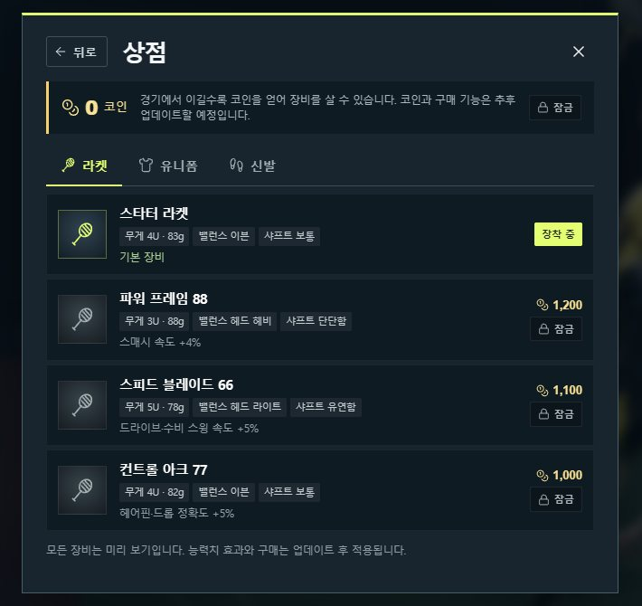
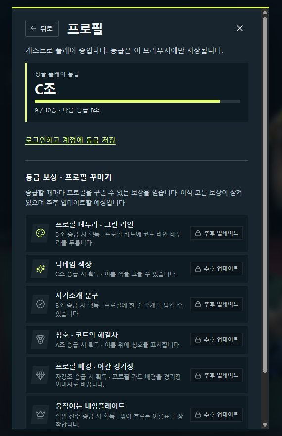

<div align="center">

# 🏸 Minton Web Game

**브라우저에서 바로 즐기는 1인칭 배드민턴 복식 게임**<br>
WASD로 코트를 누비고, 마우스 스윙 하나로 드라이브·스매시·헤어핀을 구사하세요.

[](https://badminton-web-game.vercel.app/)
[](https://docs.google.com/forms/d/e/1FAIpQLScbD-jT6Vie694ulgbSymw9GH7G_T7qb0W_ov8afK24jioXFw/viewform)




</div>

---

## 목차

- [게임 소개](#-게임-소개)
- [스크린샷](#-스크린샷)
- [게임 모드](#-게임-모드)
- [조작법](#-조작법)
- [타구 시스템](#-타구-시스템)
- [등급과 승급](#-등급과-승급)
- [상점과 등급 보상](#-상점과-등급-보상)
- [시작하기](#-시작하기)
- [프로젝트 구조](#-프로젝트-구조)
- [기술 스택](#-기술-스택)
- [에셋과 출처](#-에셋과-출처)
- [로드맵](#-로드맵)

---

## 🎮 게임 소개

Minton Web Game은 **선수의 눈높이에서 치는 배드민턴 복식 게임**입니다. 화면에는 내 라켓만 보이고, 네트 건너편의 상대 두 명과 옆의 AI 파트너가 실제 선수 모션으로 움직입니다. 콕을 따라 직접 뛰어가고, 마우스를 놓는 타이밍과 드래그 방향으로 타구를 결정합니다.

| | |
|---|---|
| 🏟️ **1인칭 복식 코트** | 녹색 코트, 붉은 외곽, 빈 관중석과 18m 높이 천장의 BWF 스타일 경기장 |
| 🖱️ **마우스 스윙** | 좌클릭 백핸드 · 우클릭 포핸드. 드래그 방향과 세기로 구질과 코스를 결정 |
| ⏱️ **타이밍이 곧 속도** | 타이밍 원이 정확히 겹칠수록 빠른 타구, 늦거나 이르면 느려짐 |
| 🤝 **AI 파트너와 호흡** | 파트너가 위치를 잡고, 내 쪽 공과 파트너 쪽 공이 나뉨 |
| 🏆 **8단계 등급** | 초심부터 국가대표까지, 10승마다 승급하는 랭크 시스템 |
| 🔊 **실제 타구음** | 라켓에 콕이 맞는 실제 녹음. 타구 세기와 거리·방향에 따라 음량과 음색이 바뀜 |

## 📸 스크린샷

<table>
  <tr>
    <td width="50%"><br><sub><b>경기 화면</b> · 점수판, 직전 타구, 미니맵 HUD</sub></td>
    <td width="50%"><br><sub><b>경기 준비</b> · 상대 난이도와 승급전 표시</sub></td>
  </tr>
</table>

<table>
  <tr>
    <td width="33%"><br><sub><b>난이도 선택</b> · 내 등급 이하만 선택 가능</sub></td>
    <td width="33%"><br><sub><b>상점</b> · 장비 미리 보기 (잠금)</sub></td>
    <td width="33%"><br><sub><b>프로필</b> · 등급과 꾸미기 보상 (잠금)</sub></td>
  </tr>
</table>

## 🕹️ 게임 모드

| 모드 | 설명 | 상태 |
|---|---|:---:|
| **싱글 플레이** | AI 파트너와 함께 AI 2명을 상대하는 21점 복식 경기. 승리가 등급에 반영됩니다. | ✅ |
| **AI 연습** | 점수 없이 상대 AI의 서브와 리턴을 반복해서 받습니다. 8개 난이도 중 아무거나 고를 수 있습니다. | ✅ |
| **멀티 플레이** | 온라인 복식 매치 | 🔒 업데이트 예정 |

## ⌨️ 조작법

| 입력 | 동작 |
|---|---|
| <kbd>W</kbd> <kbd>A</kbd> <kbd>S</kbd> <kbd>D</kbd> | 바라보는 방향으로 코트 이동 |
| <kbd>Space</kbd> | 점프 |
| 마우스 이동 | 시선 회전 |
| <kbd>F</kbd> | 콕 쪽으로 바로 시선 돌리기 |
| **좌클릭** / **우클릭** | 백핸드 / 포핸드 스윙 |
| <kbd>Esc</kbd> | 일시정지 · 설정 · 조작법 |

> 💡 버튼을 누른 동안의 마우스 움직임은 **스윙 궤적**이 되고, 시선도 같은 방향으로 약하게 따라갑니다. **타이밍 원이 겹치는 순간 버튼을 놓으세요.**

시점 높이, 시야각, 코트 크기, 마우스 감도, 스윙 폭, 타구 음량은 경기 중 **설정** 메뉴에서 조절할 수 있습니다.

## 🏸 타구 시스템

클릭과 드래그의 방향·세기, 그리고 **콕의 높이**에 따라 타구가 정해집니다.

| 상황 | 입력 | 타구 |
|---|---|---|
| 어디서든 | 클릭 | 직선 **드라이브** |
| 어디서든 | 클릭 + 좌우 드래그 | 좌우 방향 **드라이브** |
| 콕이 높을 때 | 아래로 짧게 | **드롭** (네트 앞에 떨어뜨리기) |
| 콕이 높을 때 | 아래로 강하게 | **스매시** · 사선 각도로 코스 조절 (대각 스매시) |
| 콕이 높을 때 | 위로 | **클리어** |
| 콕이 높을 때 | 부드러운 반원 | 공격 **커트** |
| 콕이 낮을 때 | 위로 강하게 / 약하게 | **언더** / 수비 **커트** |
| 콕이 낮을 때 | 부드러운 반원 | 수비 **커트** |
| 네트 앞 | 클릭 | **헤어핀** |
| 네트 앞 | 클릭 + 좌우 드래그 | **크로스 헤어핀** |
| 서브 | 클릭 / 위로 끌기 | **쇼트 서브** / **롱 서브** |

**타구 속도**는 타이밍 게이지로 정해집니다. 타이밍이 정확할수록 가장 빠르고, 어긋날수록 느려집니다.

## 🏆 등급과 승급

싱글 플레이는 **8단계 등급**으로 이루어져 있습니다. 현재 등급에서 **10승**하면 다음 등급으로 승급하고, **9/10승**일 때는 다음 경기가 `승급전`으로 표시됩니다.

| # | 등급 | 상대 특징 |
|:-:|---|---|
| 01 | 초심 | 느린 발과 잦은 실수. 랠리에 익숙해지는 단계 |
| 02 | D조 | 기본 리턴은 하지만 코스가 단조롭습니다 |
| 03 | C조 | 빈 곳을 노리기 시작하고 실수가 줄어듭니다 |
| 04 | B조 | 스매시가 섞이고 수비 범위가 넓어집니다 |
| 05 | A조 | 빠른 반응과 공격적인 결정구. **여기서부터 어렵습니다** |
| 06 | 자강조 | 실수가 거의 없고 코스를 정확히 찌릅니다 |
| 07 | 실업 선수 | 프로 수준의 발과 공격 전개 |
| 08 | 국가대표 | 거의 모든 공을 받아내는 최상위 상대 |

- 싱글 플레이에서는 **내 등급부터 초심까지** 고를 수 있습니다. 낮은 등급과의 경기는 승급에 집계되지 않습니다.
- AI 연습에서는 모든 난이도를 고를 수 있습니다.
- 로그인하면 등급이 계정에 저장되고 이름 옆에 표시됩니다 (예: `민턴러 B조`). 게스트는 이 브라우저에만 저장됩니다.

## 🛍️ 상점과 등급 보상

> 🔒 아래 기능은 **미리 보기**입니다. 지금은 모두 잠겨 있으며 추후 업데이트에서 열립니다.

- **상점**: 경기에서 이기면 코인을 얻고, 라켓·유니폼·신발을 구매합니다. 장비마다 무게, 밸런스, 소재 같은 사양과 능력치 효과가 있습니다.
- **등급 보상**: 승급할 때마다 프로필 테두리, 닉네임 색상, 자기소개 문구, 칭호, 프로필 배경, 네임플레이트, 국가대표 엠블럼 등 프로필 꾸미기 아이템을 얻습니다.

## 🚀 시작하기

### 바로 플레이

설치 없이 **[badminton-web-game.vercel.app](https://badminton-web-game.vercel.app/)** 에서 플레이할 수 있습니다. PC 브라우저(Chrome·Edge 권장)와 마우스가 필요합니다.

> 공개 사이트는 정적 배포라 **게스트 모드**로 동작합니다. 로그인과 계정 등급 저장은 로컬 서버에서만 사용할 수 있습니다.

### 로컬에서 실행

[Node.js](https://nodejs.org/) **22.5 이상**이 필요합니다. 실행에 필요한 라이브러리는 저장소에 포함되어 있어 별도 설치가 필요 없습니다.

```sh
git clone https://github.com/kimjm11034-boop/badminton-web-game.git
cd badminton-web-game
npm run dev
```

브라우저에서 **http://localhost:5173** 을 엽니다. 로컬 서버에서는 계정 만들기와 로그인이 동작하며, 계정 정보는 `.local/accounts.sqlite`에 저장됩니다(버전 관리 제외).

| 명령 | 설명 |
|---|---|
| `npm run dev` | 개발 서버 실행 (파일 저장 시 자동 새로고침) |
| `npm test` | 물리·경기 규칙·등급·계정 테스트 실행 |
| `node tools/build-playtest.mjs` | 배포용 정적 파일을 `.cache/playtest-public`에 생성 |

### 배포

`main` 브랜치에 푸시하면 Vercel이 `vercel.json` 설정대로 `tools/build-playtest.mjs`를 실행해 자동 배포합니다.

## 📁 프로젝트 구조

```text
badminton-web-game/
├─ index.html              # 로비 (게임 첫 화면)
├─ play/index.html         # 경기 화면 (싱글 · AI 연습)
├─ lobby/                  # 로비 UI
│  ├─ home.js · home.css   #   메뉴, 패널, 로그인, 상점, 프로필
│  ├─ catalog.js           #   상점 장비 · 등급 보상 데이터
│  ├─ spotlight.js         #   로비 선수 이미지
│  ├─ accounts.mjs         #   계정 · 로그인 기록 · 계정 등급 API (SQLite)
│  └─ photos/              #   로비 배경과 선수 이미지
├─ doubles/                # 1인칭 복식 게임
│  ├─ match.js             #   입력, HUD, 메뉴, 경기 진행
│  ├─ simulation.js        #   복식 규칙, AI 이동과 타구, 서브 순서
│  ├─ court.js · arena.js  #   Three.js 코트, 경기장, 선수, 라켓 렌더링
│  ├─ ranks.js             #   8단계 등급, 승급 규칙
│  ├─ impact-audio.js      #   타구음 재생
│  └─ assets/              #   선수 · 라켓 · 셔틀콕 GLB, 타구음
├─ physics.js              # 셔틀콕 궤적(항력), 타구 속도, 타이밍
├─ vendor/                 # Three.js, Lucide 아이콘 (저장소에 포함)
├─ tests/                  # node:test 테스트
├─ tools/build-playtest.mjs# 배포 빌드
├─ dev-server.mjs          # 로컬 개발 서버
├─ court-studio/           # 선수 모델 · 모션 제작 작업장 (Blender 원본)
├─ motion-lab/             # 선수 관절 데이터 수집 · 검수 도구
└─ docs/                   # 개발 기록, README 이미지, 이전 프로토타입 문서
```

<details>
<summary><b>이전 버전 파일</b></summary>

루트의 `game.js`, `style.css`, `renderer3d.js`, `motion.js`, `footwork-clips.js`는 이전 3인칭 단식 프로토타입(SHUTTLE LAB)의 파일입니다. 지금 게임은 쓰지 않지만 기록용으로 남겨 두었습니다. 당시 설명은 [docs/legacy-prototype.md](docs/legacy-prototype.md)에 있습니다. 개발 중 한 번씩 쓴 검증 스크립트는 `tools/archive/`에 있습니다.

</details>

## 🧰 기술 스택

| 영역 | 사용 기술 |
|---|---|
| 렌더링 | [Three.js](https://threejs.org/) r187 (WebGL, GLTF, SkeletonUtils) |
| 게임 로직 | Vanilla JavaScript (ES Modules), 고정 시간 간격 물리 시뮬레이션 |
| UI | HTML · CSS, 네이티브 `<dialog>` 모달, [Lucide](https://lucide.dev/) 아이콘 |
| 사운드 | Web Audio API (거리·방향에 따른 음량과 좌우 위치) |
| 서버 | Node.js `http` + `node:sqlite` (계정, 로그인 기록, 등급) |
| 3D 제작 | Blender, [TripoSR](https://huggingface.co/stabilityai/TripoSR) (Tripo AI · Stability AI) |
| 테스트 · 배포 | `node:test`, Vercel |

## 🎨 에셋과 출처

| 에셋 | 출처 |
|---|---|
| 셔틀콕 3D 모델 | Stanislas Perrin의 퍼블릭 도메인 사진을 TripoSR로 복원하고 Blender에서 보정 · [자세히](doubles/assets/SOURCES.md) |
| 선수 3D 모델 | 가상 선수 원화를 TripoSR로 복원하고 Blender에서 리그에 맞춤. 얼굴·손·신발 바탕은 [GameMog](https://gamemog.com/library) MakeHuman 기반 메시 (MIT) · [자세히](doubles/assets/SOURCES.md) |
| 선수 모션 | 공개 배드민턴 전신 센서 기록과 경기 영상의 관절 추정을 바탕으로 Blender에서 67개 동작 제작 · [자세히](court-studio/SOURCES.md) · [라이선스 고지](court-studio/build/ATTRIBUTION.txt) |
| 라켓 | 이 프로젝트의 Blender 작업장에서 제작 (`court-studio/Astra-Court.blend`) |
| 타구음 | Joseph Sardin, [BigSoundBank #0537](https://bigsoundbank.com/badminton-volant-sur-raquette-s0537.html) · [편집 기록](doubles/assets/audio/SOURCE.txt) |
| 로비 배경 | 게임 경기장 3D 렌더 |
| 로비 선수 일러스트 | AI 생성 이미지 |
| 아이콘 | Lucide (ISC License) · 라켓 아이콘은 같은 선 스타일로 자체 제작 |
| 3D 엔진 | Three.js (MIT License) |

## 🗺️ 로드맵

- [x] 1인칭 복식 경기와 마우스 스윙 타구
- [x] AI 파트너 · 상대 2명, 실제 선수 모션 적용
- [x] 8단계 등급과 10승 승급, 계정 등급 저장
- [x] 로비, 난이도 선택 모달, 설정 · 일시정지 메뉴
- [ ] 코인 획득과 상점 장비 구매
- [ ] 등급 보상으로 프로필 꾸미기
- [ ] 온라인 멀티 플레이와 친구 초대
- [ ] 공개 서버 계정 (온라인 DB 연결)
- [ ] 모바일 화면 최적화

---

<div align="center">

**문의** · [GitHub @kimjm11034-boop](https://github.com/kimjm11034-boop) · [kimjm11034@gmail.com](mailto:kimjm11034@gmail.com)

<sub>플레이 후기와 버그 제보는 언제든 환영합니다. 🏸</sub>

</div>
